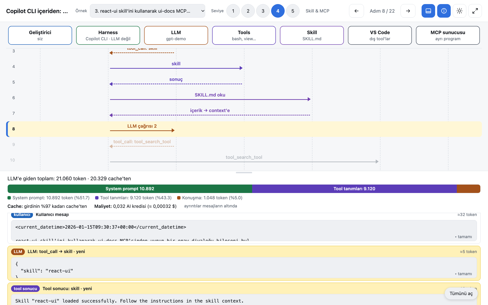
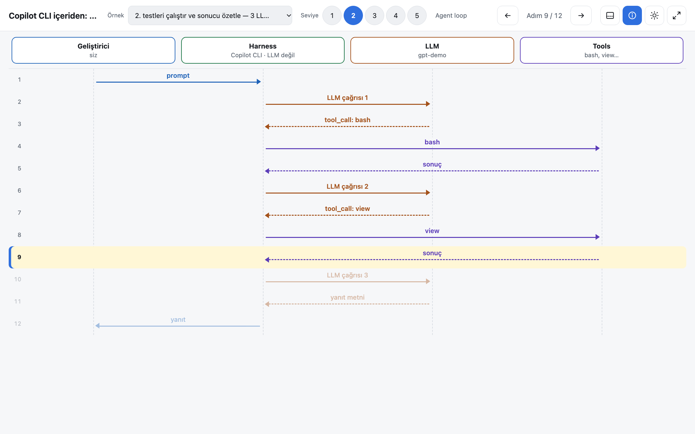
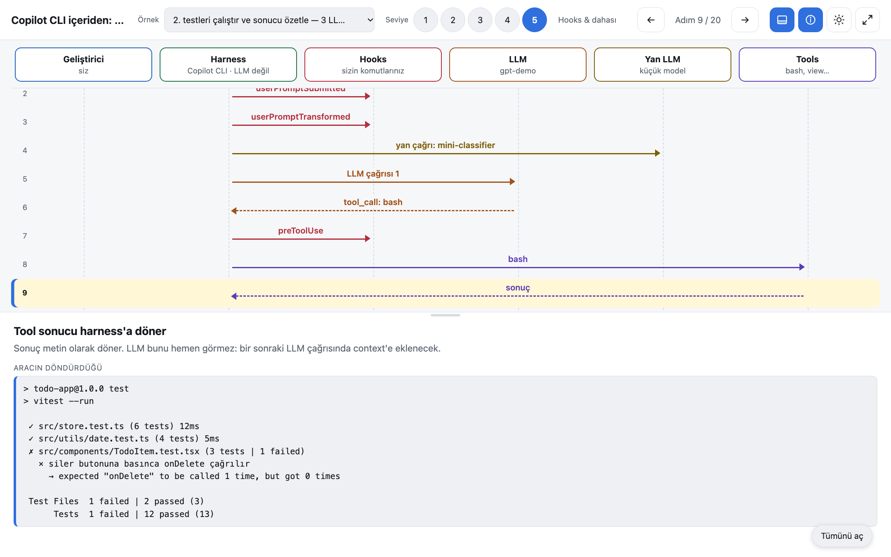

# Copilot CLI Log Player

GitHub Copilot CLI'ın kendi oturum logundan (`events.jsonl`) **adım adım gezilebilen bir eğitim sayfası** üretir. Bir isteğin içeride nasıl işlendiğini gerçek veriyle gösterir: kullanıcı → Copilot CLI → LLM → araç → tekrar LLM döngüsü, her LLM çağrısında modele giden mesajların tamamı, token dökümü, skill'ler, MCP çağrıları ve hook'lar.

> *English:* Turns a GitHub Copilot CLI session log (`events.jsonl`) into a single-file, step-by-step HTML player for teaching how an agent request really flows: user → CLI → LLM → tool → LLM, the exact messages sent on every LLM call, token breakdown, skills, MCP and hooks. Five difficulty levels reveal detail gradually. No dependencies; everything runs locally. The UI is in Turkish.



*Seviye 4 · skill yüklendikten sonraki LLM çağrısı. Üstte kim kime ne gönderdi; altta bu çağrıda LLM'e giden 21.045 token'ın dökümü ve mesajların kendisi. Sarı olanlar bu çağrıda yeni eklenenler.*

| Seviye 2 · araç döngüsü (panel gizli) | Seviye 5 · hook'lar ve yan model |
|---|---|
|  |  |

<sub>Görseller tamamen uydurma bir demo oturumdan üretildi: [`examples/demo-events.jsonl`](examples/demo-events.jsonl).</sub>

## Neden?

Copilot'ın "nasıl çalıştığını" anlatan şemalar genelde temsilîdir. Oysa Copilot CLI her oturumda olan biteni zaten logluyor: hangi prompt'un LLM'e nasıl gittiği, modelin hangi aracı istediği, aracın ne döndürdüğü, kaç token harcandığı… Bu araç o logu, eğitimde ekrana yansıtılabilecek bir anlatıma çeviriyor.

## Özellikler

- **Üstte akış, altta gerçek metin.** Sütun başlıkları sabit; her adımda alt panelde logda ne yazıyorsa o görünür.
- **LLM'e giden mesajın kendisi.** Her LLM çağrısında modele giden mesaj listesi sırasıyla gösterilir; o çağrıda yeni eklenenler sarıyla işaretlenir.
- **Önbellek ve kredi.** Her çağrıda girdinin ne kadarının önbellekten okunduğu, çağrının AI kredisi maliyeti ve dolar karşılığı, istenirse aylık hakkınızın ne kadarı olduğu, prompt başına premium istek sayısı.
- **Token dökümü.** Girdinin ne kadarı sistem prompt'u, ne kadarı araç tanımları, ne kadarı konuşma geçmişi; sistem prompt'unun bölümleri (copilot-instructions.md, AGENTS.md, skill listesi…).
- **5 seviye, basitten zora.** Seviye değiştirince aynı adımda kalırsınız; ayrıntı açılır veya kapanır.
- **Sunum modu.** Tam ekran, büyük yazı, açık/koyu tema, alt paneli gizleme.
- **Bağımlılık yok.** Python 3.9+ standart kütüphanesi; çıktı tek bir HTML dosyası, internet gerektirmez.

## Kurulum ve kullanım

```bash
git clone https://github.com/cnkbekir/copilot-cli-log-player
cd copilot-cli-log-player
```

1. Copilot CLI'da anlatmak istediğiniz örnekleri yazın (aynı oturumdaki her prompt sayfada ayrı bir sekme olur).
2. Oturumun logunu bulun; en yenisi genelde en son değişen klasördür:

   ```bash
   ls -t ~/.copilot/session-state | head -3
   ```

3. Oynatıcıyı üretin ve tarayıcıda açın:

   ```bash
   python3 copilot_log_player.py ~/.copilot/session-state/<oturum-id>/events.jsonl -o egitim.html
   ```

   İsteğe bağlı başlık: `--baslik "Copilot içeriden"`.

**Hemen denemek için** (Copilot CLI gerekmez):

```bash
python3 copilot_log_player.py examples/demo-events.jsonl -o demo.html
```

### Aylık kredi hakkı

Planınızın aylık AI kredisi hakkını verirseniz, maliyetler bu hakkın ne kadarı olduğuyla birlikte gösterilir. Belgeye göre Pro 1.500, Pro+ 7.000 kredi; Business ve Enterprise için hak kuruluşa göre değişir.

```bash
python3 copilot_log_player.py <events.jsonl> --aylik-kredi 1500 -o egitim.html
```

### Uzun oturumlar

Bir oturumda onlarca prompt olabilir. Hepsi sayfadaki **Örnek** listesinde yer alır; yalnızca eğitimde kullanacaklarınızı almak için:

```bash
python3 copilot_log_player.py <events.jsonl> --list                # numaralarıyla listele
python3 copilot_log_player.py <events.jsonl> --promptlar 2,5,9-11 -o egitim.html
```

### Belirli bir adıma link

Sayfa adresine eklenen parametrelerle doğrudan bir örnek, seviye ve adım açılır (hepsi isteğe bağlı):

```
egitim.html#ornek=3&seviye=4&adim=8&panel=0&tema=light&sunum=1
```

## Seviyeler

| Seviye | Görünen sütunlar | Ne eklenir |
|---|---|---|
| 1 · LLM ile konuşma | Geliştirici, Copilot CLI, LLM | İstek → LLM → yanıt. Sistem prompt'u tek satır "gizli talimatlar" olarak görünür. |
| 2 · Araç döngüsü | + Araçlar | tool_call → araç → sonuç → tekrar LLM. Skill / VS Code / MCP araçları da "Araçlar" sütununda. |
| 3 · Bağlam | (aynı) | Token çubuğu, önbellek (cache) kullanımı, AI kredisi maliyeti, sistem prompt'unun bölümleri, CLI'ın prompt'a eklediği metinler, modelin düşünce özeti |
| 4 · Skill & MCP | + Skill, VS Code, MCP | SKILL.md'nin yüklenmesi, `tool_search_tool`, MCP sunucusu |
| 5 · Hooks & dahası | + Hooks, Yan LLM | Tüm hook'lar (girdi/çıktı), ana modelden ayrı çalışan küçük modeller |

İpucu: Seviye 1'i araç kullanmayan bir örnekle (ör. "merhaba") anlatın; araçlı örnekler Seviye 2'den itibaren anlamlıdır.

## Tuşlar

| Tuş | İşlev |
|---|---|
| `←` `→` / `Space` | Önceki / sonraki adım |
| `Home` `End` | İlk / son adım |
| `1` – `5` | Seviye |
| `P` | Sonraki örnek (prompt); tümü için üstteki **Örnek** listesi |
| `F` | Sunum modu (tam ekran + büyük yazı) |
| `+` `−` | Sunum modunda yazı boyutu |
| `T` | Tema: otomatik → açık → koyu |
| `H` | Alt paneli gizle / göster |
| `A` | Alt paneldeki tüm mesaj kutularını ve ayrıntıları aç / kapat (adımlar arasında korunur) |

Bir satıra tıklamak o adıma gider; alt paneldeki uzun metin kutularına tıklamak tamamını açar.

## Sayılar nereden geliyor?

| Değer | Kaynak |
|---|---|
| Bir çağrının toplam girdi/çıktı token'ı, önbellekten okunan ve önbelleğe yazılan token | Ölçülmüş (`session.usage_record`) |
| Araç tanımlarının token'ı ve araç sayısı | Ölçülmüş (`toolTokenCount`, `availableToolCount`) |
| Bir çağrının maliyeti, token türüne göre birim fiyatlar | Ölçülmüş (`copilotUsage.totalNanoAiu`, `tokenDetails`, nanoAIU cinsinden) |
| AI kredisi ve dolar karşılığı | Hesaplanmış: nanoAIU ÷ 10⁹ = AI kredisi ([Copilot SDK belgesi](https://docs.github.com/en/copilot/how-tos/copilot-sdk/features/usage-and-billing)), 1 AI kredisi = 0,01 $ ([fatura belgesi](https://docs.github.com/en/billing/concepts/product-billing/github-copilot-billing)). Kesin tutar için GitHub'daki kullanım sayfanızla karşılaştırın. |
| Konuşma geçmişinde görünmeyen kısım | Hesaplanmış: ölçülen konuşma toplamı − görünen mesajların tahmini (çoğunlukla şifreli düşünce blokları) |
| Prompt başına premium istek | Ölçülmüş (`session.usage_checkpoint` farkı) |
| Sistem prompt'unun token karşılığı | Hesaplanmış: ilk LLM çağrısının araç dışı girdisi |
| Sistem prompt'u bölümleri, tek tek mesajların token'ı | **Tahmin:** karakter sayısı × logdan çıkarılan karakter/token oranı |

LLM'e giden mesaj listesi logda tek bir olay olarak yoktur; her çağrıdan önceki kullanıcı mesajları, yanıtlar, araç sonuçları ve skill içerikleri sırayla toplanarak yeniden kurulur.

## ⚠️ Paylaşmadan önce

Üretilen HTML, logdaki **gerçek içeriği** taşır: araç çıktıları (ör. `ls -la` → kullanıcı adı, dosya adları), skill ve MCP yanıtları, modelin düşünce özeti. Ev dizini yolu `~` ile değiştirilir; geri kalanı olduğu gibi kalır. Sistem prompt'unun (copilot-instructions.md, AGENTS.md) yalnızca bölüm adları ve boyutları gösterilir, metni gösterilmez. Şirket ortamında üretilen dosyaları paylaşmadan önce içeriğini kontrol edin.

## İsteğe bağlı: Archify görünümleri

`archify/` klasöründeki script'ler aynı logdan [Archify](https://github.com/tt-a1i/archify) diyagramları için JSON üretir. Archify ayrıca kurulmalıdır.

| Script | Çıktı |
|---|---|
| `archify/copilot_log_to_archify.py <log> --prompt 3 --out <klasör>` | Sequence diyagramı + Story brief'i |
| `archify/copilot_log_views.py <log> waterfall --prompt 3 --out <klasör>` | Zaman çizelgesi: LLM mi, araç mı? |
| `archify/copilot_log_views.py <log> tree --prompt 3 --call 2 --out <klasör>` | Tek bir LLM çağrısının token dökümü |

Ardından Archify ile render edin, örneğin:

```bash
node <archify>/bin/archify.mjs finalize sequence <klasör>/candidate.json <klasör>/diyagram.html --quality showcase --json
```

## Sınırlar

- `events.jsonl` biçimi GitHub tarafından belgelenmemiştir ve sürümle değişebilir. Copilot CLI `1.0.114` ile test edildi; daha eski sürümlerde hook, skill ve MCP olayları bulunmayabilir.
- Paralel araç çağrıları, alt agent'lar (`subagent.*`) ve reddedilen araç çağrıları henüz örnek logla test edilmedi.
- Arayüz Türkçedir.

## Dosyalar

```
copilot_log_player.py         Oynatıcıyı üretir (ana giriş noktası)
copilot_player_template.html  Oynatıcının HTML/CSS/JS şablonu
copilot_log_core.py           Ortak log okuma ve özetleme fonksiyonları
archify/                      İsteğe bağlı Archify dönüştürücüleri
examples/make_demo_log.py     Uydurma demo logu üretir
examples/demo-events.jsonl    Demo log (README görselleri bundan)
docs/                         README görselleri
```

## Lisans

[MIT](LICENSE)
